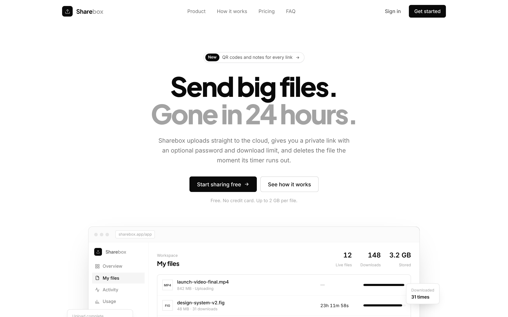
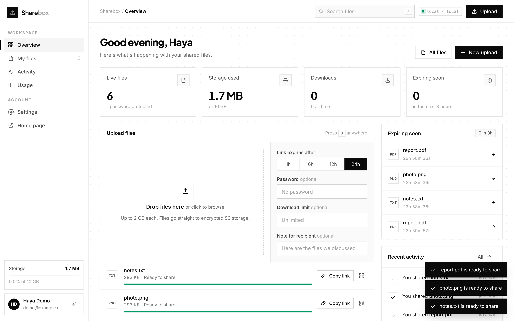
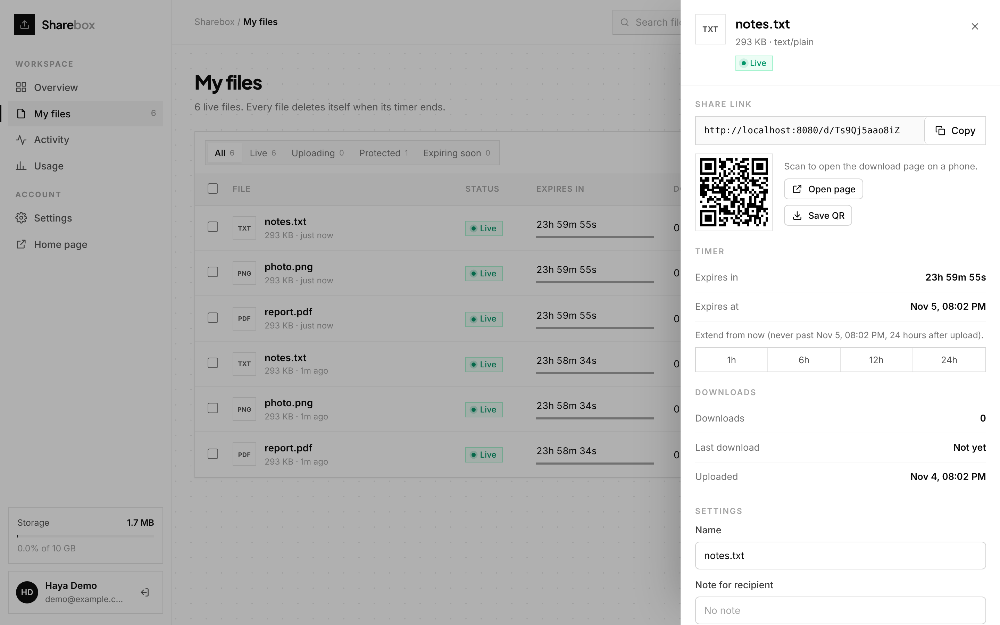
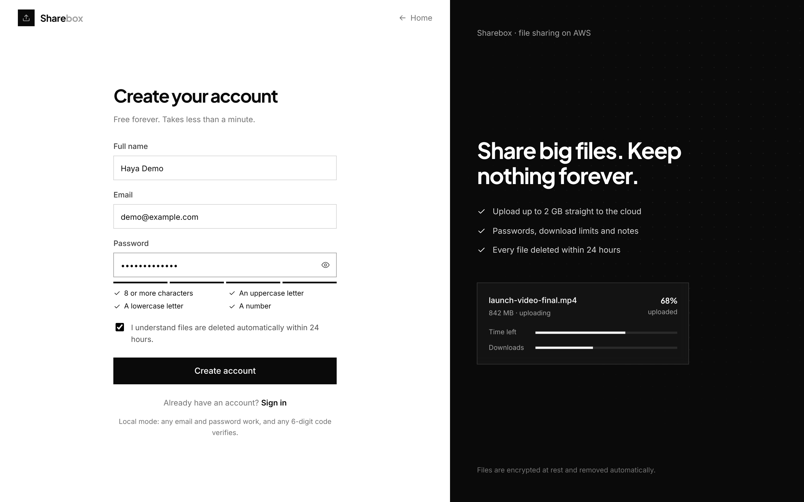
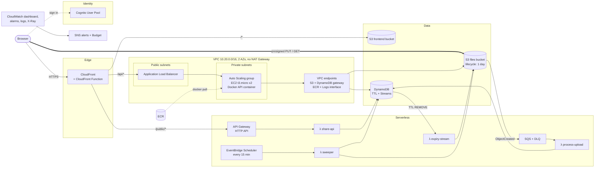

# Sharebox

**Send big files. Gone in 24 hours.**

Sharebox is a file-sharing SaaS with self-destructing links. You upload a file, get a private share link, and the file deletes itself after 1, 6, 12 or 24 hours. It runs on AWS as a production-style system: Docker containers on an auto-scaled EC2 fleet, serverless Lambda functions, S3, DynamoDB, Cognito and CloudFront. All of it is built with Terraform and shipped by a GitHub Actions pipeline.

**Live demo:** https://do1rgo79cqkcz.cloudfront.net




| Dashboard | File details |
|---|---|
|  |  |
| **Download page** | **Sign up** |
|  |  |

## Features

- **Accounts:** sign up, email verification code, sign in and password reset on custom pages, backed by Amazon Cognito
- **Fast uploads:** files of up to 2 GB go straight from the browser to S3, with live progress, speed and time left, 3 at a time, drag and drop anywhere
- **Private share links** like `https://<app>/d/Xk3pQ9aZm2Lw`, with a QR code for each one
- **Self-destructing files:** links expire after 1, 6, 12 or 24 hours, with a live countdown
- **Protection:** an optional password (hashed with scrypt) and a download limit per file
- **Notes for recipients**, shown on the download page
- **File management:** rename, extend the timer, image preview, bulk copy and delete, search, filters and sorting
- **Dashboard:** live files, storage used against a 10 GB quota, downloads, files expiring soon, an activity timeline and usage charts
- **Settings:** upload defaults and keyboard shortcuts (`/`, `U`, `G`, `F`)
- **Load balancing you can see:** each response shows which EC2 instance and Availability Zone served it
- **Design:** a responsive black and white SaaS interface with animated borders, plain JavaScript and no framework

## Concepts used

### Cloud computing

| Concept | How Sharebox uses it |
|---|---|
| **High availability** | Servers run in 2 Availability Zones behind a load balancer. If one instance or AZ fails, traffic moves to the other |
| **Elasticity and auto scaling** | The Auto Scaling group keeps CPU near 50%, scaling between 1 and 3 instances, and replaces unhealthy ones automatically |
| **Serverless** | Public download links and all background jobs run on Lambda: no servers to manage, scales instantly, costs nothing when idle |
| **Event-driven architecture** | An S3 upload triggers an event, which goes to an SQS queue and then a Lambda. A DynamoDB TTL deletion triggers a stream event and another Lambda |
| **Decoupling** | SQS sits between S3 and the processor, with a dead-letter queue for failures, so a slow or failing worker never loses an upload |
| **Content delivery (CDN)** | CloudFront serves the site from edge locations near the user and puts one HTTPS domain in front of S3, the load balancer and API Gateway |
| **Object storage** | Files live in S3 and are uploaded and downloaded through short-lived presigned URLs, so file bytes never pass through the servers |
| **NoSQL database** | DynamoDB on-demand, with a secondary index for "files by owner", TTL for automatic expiry, Streams, and conditional writes to prevent race conditions |
| **Managed identity** | Cognito handles accounts, email verification, passwords and JWT tokens. The API verifies tokens on every request |
| **Private networking** | Its own VPC with public and private subnets. Servers have no public IP and reach AWS services through VPC endpoints, without a NAT gateway |
| **Security in layers** | Only CloudFront can reach the load balancer (AWS prefix list plus a secret header), only the load balancer can reach the servers, and buckets block all public access |
| **Least privilege** | Every Lambda and the EC2 instances get their own IAM role, allowed only the exact actions and resources they need. No access keys are stored anywhere |
| **Cost optimization** | Pay-per-request services, ARM (Graviton) Lambdas, no NAT gateway, log retention limits, a monthly budget alert, and one-command teardown |

### AWS services

| Service | Role in the project |
|---|---|
| **EC2 + Auto Scaling** | Runs the API in Docker on t3.micro instances across 2 AZs, with rolling instance refresh for zero-downtime deploys |
| **Elastic Load Balancing (ALB)** | Spreads traffic over healthy instances, health-checks `/health`, drains connections gracefully |
| **ECR** | Private Docker registry with scan-on-push and a lifecycle policy |
| **Lambda** | 4 functions: `share-api` (public links), `process-upload` (after upload), `expiry-stream` (TTL cleanup), `sweeper` (scheduled cleanup) |
| **API Gateway** | HTTP API in front of the public share Lambda, with throttling to block abuse |
| **S3** | File storage (encrypted, private, TLS-only, deleted after 1 day by a lifecycle rule) and website hosting |
| **CloudFront** | CDN with 3 origins, Origin Access Control, security headers, HTTP/3, and a CloudFront Function for URL rewrites |
| **DynamoDB** | File records and per-user stats, with TTL, Streams and point-in-time recovery |
| **Cognito** | User pool for sign up, sign in, verification codes and password reset |
| **SQS** | Upload events queue plus dead-letter queue |
| **EventBridge Scheduler** | Runs the cleanup Lambda every 15 minutes |
| **VPC** | Subnets, route tables, internet gateway, security groups, and gateway and interface endpoints |
| **IAM** | Roles for EC2, each Lambda, and GitHub Actions through OIDC federation |
| **CloudWatch** | Dashboard, alarms, structured logs, custom metrics (Embedded Metric Format) |
| **X-Ray** | Request tracing across the Lambdas |
| **SNS** | Sends alarm emails |
| **AWS Budgets** | Monthly cost alerts |

### DevOps

| Practice | How it's done |
|---|---|
| **Infrastructure as Code** | All of the infrastructure is Terraform (`infra/`), so it can be reviewed, versioned and recreated |
| **One-command deploy and teardown** | `scripts/deploy.sh` builds, tests, pushes and applies everything. `scripts/destroy.sh` removes it all |
| **Continuous integration** | Every push and pull request runs unit tests, `terraform fmt` and `validate`, a Docker build with a smoke test, and a Trivy vulnerability scan |
| **Continuous deployment** | Every push to `main` builds the image (tagged with the commit SHA), pushes it to ECR, updates the Lambdas, syncs the website, clears the CloudFront cache and rolls the EC2 fleet |
| **Keyless CI/CD** | GitHub Actions gets short-lived AWS credentials through OIDC, limited to this repo's `main` branch and `production` environment |
| **Zero-downtime releases** | Auto Scaling instance refresh with 50% minimum healthy, plus graceful shutdown in the app |
| **Monitoring and alerting** | CloudWatch dashboard and alarms for 5xx errors, unhealthy hosts, Lambda errors and queue backlog, sent by email through SNS |
| **Testing** | Node's built-in test runner covers the core logic, the API and the Lambdas |
| **Local development** | Runs fully offline with `npm run dev`, emulating S3 presigned URLs, events and authentication |

### Docker

- **Multi-stage build:** dependencies are installed in one stage, and only the runtime files are copied into a small `node:22-alpine` image
- **Runs as a non-root user**, with a container health check and a `/data` directory for local files
- **Built for linux/amd64**, so it runs the same on a laptop and on EC2
- **Tagged with the git commit SHA** plus `latest`, stored in ECR and scanned for vulnerabilities on push
- **EC2 instances pull and start the container at boot** (user data), with logs sent to CloudWatch
- **`docker compose up`** runs the production image locally

## Architecture



### How a file moves through the system

1. **Sign in.** The custom sign-in page calls the Cognito API directly (sign up, email code, sign in, refresh, reset password) and keeps the JWTs in the browser.
2. **Upload.** The dashboard calls `POST /api/files` (CloudFront → ALB → EC2). The API checks the quota, writes a `pending` item to DynamoDB with a `ttl`, and returns a **presigned S3 PUT URL** with the size and type signed in. The browser uploads straight to S3, so file bytes never pass through EC2.
3. **Process.** S3 emits `ObjectCreated` → **SQS** (dead-letter queue after 3 failures) → **`process-upload` Lambda**, which marks the file `ready` and removes orphaned uploads.
4. **Share.** A recipient opens `/d/<id>`. A **CloudFront Function** rewrites it to `share.html`, which calls `/public/files/<id>` → **API Gateway → `share-api` Lambda**. On download, the Lambda checks the password, increments the count with a **conditional DynamoDB update** (so expiry and download limits can't be raced), and returns a **5-minute presigned GET URL**.
5. **Expire.** Three layers, each a backstop for the one before:
   - **`sweeper` Lambda** on an **EventBridge Scheduler** every 15 minutes deletes expired files on time, plus uploads that never finished.
   - **DynamoDB TTL** deletes stale items → **DynamoDB Streams** (filtered to `REMOVE`) → **`expiry-stream` Lambda** deletes the S3 object.
   - **S3 lifecycle rule** deletes anything under `uploads/` after 1 day, even if every Lambda failed.

## Design decisions

- **Why presigned URLs?** EC2 never handles file bytes, so a t3.micro can serve thousands of uploads. S3 does the heavy lifting and scales on its own.
- **Why split EC2 and Lambda?** The signed-in dashboard is steady traffic that suits a small always-on fleet. Public share links are spiky (one link can go viral), so they go to API Gateway + Lambda, which scales out instantly and costs nothing when idle. API Gateway throttling (20 rps, burst 50) caps abuse.
- **Why three expiry mechanisms?** DynamoDB TTL is free but can lag by hours, the scheduled sweeper is precise, and the S3 lifecycle rule is the safety net that needs no code. The download path also checks `expiresAt`, so an expired file is never served, even before cleanup runs.
- **Why no NAT Gateway?** A NAT Gateway costs about $33/month before data. Private instances reach S3 and DynamoDB through free gateway endpoints and ECR and Logs through three interface endpoints placed in one AZ. Cognito's signing keys are fetched by Terraform and passed to the app, so the instances need no internet at all.
- **Why CloudFront in front of everything?** It gives one HTTPS origin without buying a domain, so there's no CORS for the API and Cognito gets the HTTPS callback it requires. The ALB only accepts CloudFront traffic.
- **Why DynamoDB and not RDS?** The access patterns are key lookups and "files by owner", which fit a table with a GSI. On-demand billing has no idle cost, and TTL and Streams drive the expiry pipeline. RDS would add about $15/month and a VPC dependency for the Lambdas.

## Repository layout

```
core/       Shared domain logic (used by the API and the Lambdas) + DynamoDB/S3 adapters
app/        Express API, runs in Docker on EC2 (Dockerfile here)
lambdas/    share-api, process-upload, expiry-stream, sweeper (bundled with esbuild)
frontend/   Static dashboard + share page (vanilla JS, no build step)
infra/      Terraform for the whole AWS stack
scripts/    deploy.sh and destroy.sh
.github/    CI (tests, terraform validate, Docker build + Trivy scan) and CD (OIDC deploy)
```

## Run it locally (no AWS account needed)

```bash
npm ci
npm run dev          # http://localhost:8080
```

Local mode uses an in-memory database, stores files in `.data/`, accepts any email and 6-digit code for sign-in, and emulates presigned URLs, the S3 event Lambda and the CloudFront `/d/<id>` rewrite. You can upload, share, password-protect and download exactly as in AWS. You can also run the production image with `docker compose up`.

```bash
npm test             # unit tests for core, app and lambdas
```

## Deploy to AWS

You need an AWS account, the [AWS CLI](https://docs.aws.amazon.com/cli/latest/userguide/getting-started-install.html) configured with `aws configure`, [Terraform](https://developer.hashicorp.com/terraform/install) 1.6+, [Docker](https://docs.docker.com/get-docker/) and Node.js 22. On Windows, run the scripts in Git Bash.

```bash
cp infra/terraform.tfvars.example infra/terraform.tfvars   # set alert_email (and github_repo for CI/CD)
bash scripts/deploy.sh                                      # about 15 to 20 minutes
```

The script runs the tests, bundles the Lambdas, builds and pushes the Docker image to ECR, and applies the Terraform stack. It prints the app URL when it finishes. Confirm the subscription email AWS sends to `alert_email` so alarms reach you.

**CI/CD:** with `github_repo` set, Terraform creates the OIDC role GitHub Actions uses. After that, every push to `main` deploys automatically ([`.github/workflows/deploy.yml`](.github/workflows/deploy.yml)).

**Tear down:** `bash scripts/destroy.sh` deletes everything, including stored files and images.

## Cost

About **$2 a day** while running in us-east-1, or about $1 with `private_instances = false` and `asg_desired = 1`. Most of it is the load balancer, the EC2 instances and the VPC interface endpoints. The serverless parts cost a few cents at demo traffic. Destroy the stack between demos to pay almost nothing.

## Ideas for next steps

- Custom domain with Route 53 and ACM
- AWS WAF on CloudFront with rate-based rules
- Multipart uploads and S3 Transfer Acceleration for files over 5 GB
- Email the uploader when a file is downloaded (SES)
- ECS on Fargate as an alternative compute target
