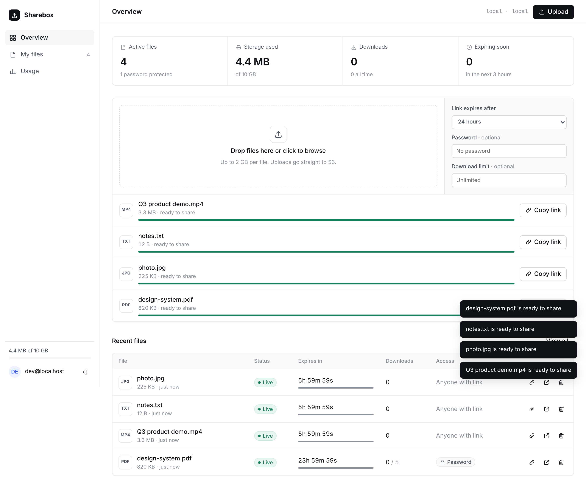
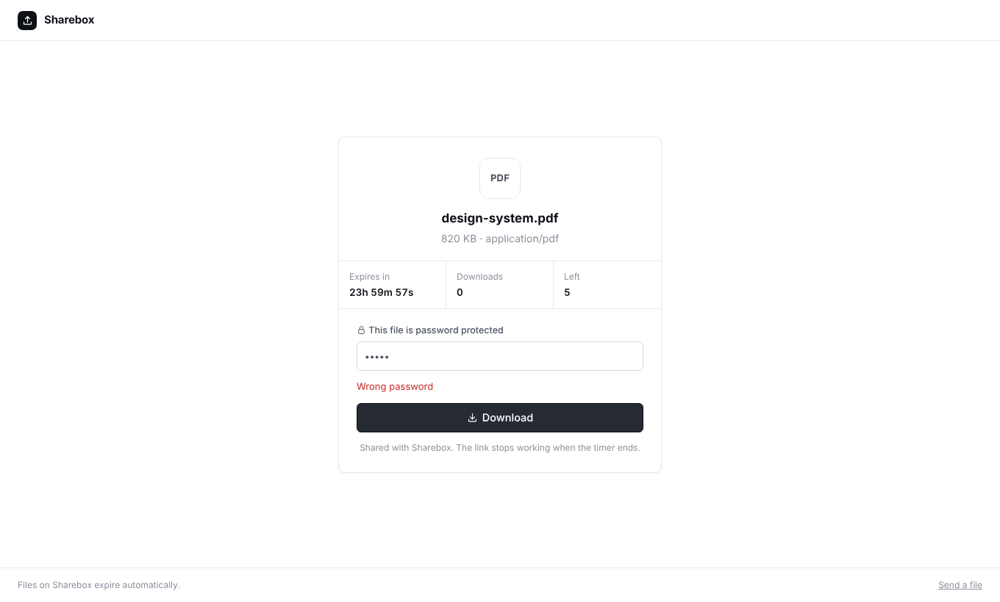
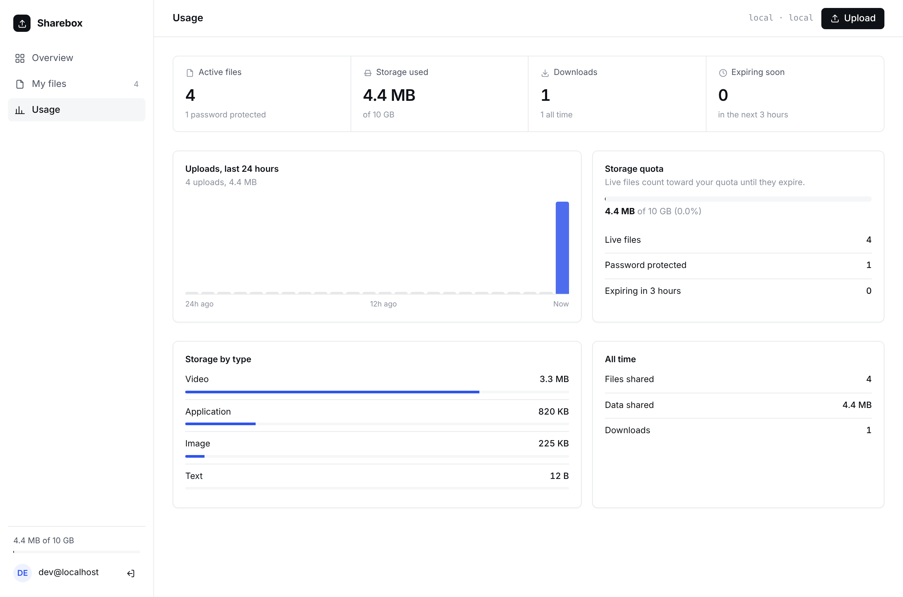
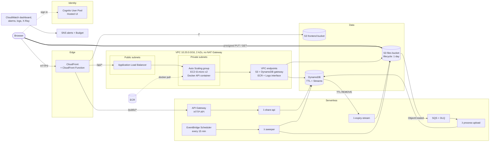

# Sharebox: file sharing with self-destructing links, on AWS

Upload a file, get a share link, and the file deletes itself after 1 to 24 hours. It's a small WeTransfer-style SaaS built to show AWS Solutions Architect (SAA-C03) design and DevOps practice end to end: Docker on EC2 behind a load balancer, serverless Lambdas, S3, DynamoDB, Cognito, CloudFront, Terraform, GitHub Actions and CloudWatch.



| Share page (password protected) | Usage |
|---|---|
|  |  |

## Features

- **Sign up / sign in** with Amazon Cognito (Hosted UI, OAuth 2.0 + PKCE)
- **Direct-to-S3 uploads** up to 2 GB with live progress, speed and time left, 3 files in parallel, drag and drop anywhere
- **Share links** like `https://<app>/d/Xk3pQ9aZm2Lw`, one click to copy
- **Auto-expiry**: 1, 6, 12 or 24 hours, with a live countdown on the dashboard and the share page
- **Optional password** (scrypt-hashed) and **download limit** per file
- **Download counts**, updated atomically
- **Dashboard**: active files, storage used against a 10 GB quota, downloads, files expiring soon
- **Usage page**: uploads per hour over 24 hours, storage by file type, all-time totals
- **Delete now** at any time; the link stops working immediately
- Shows which **EC2 instance and Availability Zone** served your request, so you can watch the load balancer at work
- Clean white UI with thin borders, no framework and no build step, about 30 KB of JS and CSS, works on mobile

## Architecture



### How a file moves through the system

1. **Sign in.** The browser goes through the Cognito Hosted UI with Authorization Code + PKCE and gets JWTs.
2. **Upload.** The dashboard calls `POST /api/files` (CloudFront → ALB → EC2). The API checks the quota, writes a `pending` item to DynamoDB with a `ttl`, and returns a **presigned S3 PUT URL** with the size and type signed in. The browser uploads straight to S3, so file bytes never pass through EC2.
3. **Process.** S3 emits `ObjectCreated` → **SQS** (dead-letter queue after 3 failures) → **`process-upload` Lambda**, which marks the file `ready` and removes orphaned uploads.
4. **Share.** A recipient opens `/d/<id>`. A **CloudFront Function** rewrites it to `share.html`, which calls `/public/files/<id>` → **API Gateway → `share-api` Lambda**. On download, the Lambda checks the password, increments the count with a **conditional DynamoDB update** (so expiry and download limits can't be raced), and returns a **5-minute presigned GET URL**.
5. **Expire.** Three layers, each a backstop for the one before:
   - **`sweeper` Lambda** on an **EventBridge Scheduler** every 15 minutes deletes expired files on time, plus uploads that never finished.
   - **DynamoDB TTL** deletes stale items → **DynamoDB Streams** (filtered to `REMOVE`) → **`expiry-stream` Lambda** deletes the S3 object.
   - **S3 lifecycle rule** deletes anything under `uploads/` after 1 day, even if every Lambda failed.

## AWS and SAA-C03 concept map

| Area | What this project uses | Where |
|---|---|---|
| **Compute** | EC2 (t3.micro, Amazon Linux 2023, IMDSv2 only, encrypted gp3) running Docker | `infra/compute.tf`, `infra/templates/user_data.sh.tftpl` |
| **High availability** | Auto Scaling group across **2 AZs**, ELB health checks, self-healing | `aws_autoscaling_group.app` |
| **Elasticity** | Target-tracking scaling on 50% CPU, min 1 / max 3 | `aws_autoscaling_policy.cpu` |
| **Load balancing** | Application Load Balancer, health checks on `/health`, 30s connection draining | `aws_lb`, `aws_lb_target_group` |
| **Zero-downtime deploys** | ASG **instance refresh** (rolling, 50% min healthy), graceful SIGTERM in the app | `instance_refresh`, `deploy.yml` |
| **Containers** | Docker multi-stage build, non-root user, ECR with scan-on-push and a lifecycle policy | `app/Dockerfile`, `aws_ecr_repository` |
| **Serverless** | 4 Lambdas (Node.js 22, **arm64/Graviton**), API Gateway HTTP API, EventBridge Scheduler | `infra/lambda.tf`, `infra/api.tf` |
| **Event-driven / decoupling** | S3 events → **SQS** with **DLQ** → Lambda with partial batch responses; DynamoDB **Streams** with event filtering | `storage.tf`, `lambda.tf` |
| **Storage** | S3 presigned PUT/GET, Block Public Access, SSE-S3, TLS-only bucket policy, **lifecycle expiration**, CORS | `storage.tf` |
| **Database** | DynamoDB on-demand, **GSI** (`byOwner`), **TTL**, Streams, conditional writes, atomic counters, PITR | `aws_dynamodb_table.files` |
| **Content delivery** | CloudFront with 3 origins (S3, ALB, API Gateway), **Origin Access Control**, managed cache and security-header policies, HTTP/3 | `cdn.tf` |
| **Edge compute** | CloudFront Function for `/d/<id>` URL rewrites | `aws_cloudfront_function.rewrite` |
| **Networking** | Custom VPC, public/private subnets, route tables, IGW, **no NAT Gateway** | `network.tf` |
| **Private connectivity** | **Gateway endpoints** (S3, DynamoDB, free) and **interface endpoints** (ECR API, ECR DKR, CloudWatch Logs) | `network.tf` |
| **Defense in depth** | Security group chaining CloudFront prefix list → ALB SG → app SG, plus a secret origin header checked by an ALB listener rule | `compute.tf` |
| **Identity** | Cognito User Pool, Hosted UI, PKCE, JWT verification on EC2 with **offline JWKS** | `auth.tf`, `app/src/auth.js` |
| **IAM least privilege** | One role per Lambda, scoped to exact actions and ARNs; instance profile; no access keys anywhere | `lambda.tf`, `compute.tf` |
| **CI/CD security** | GitHub Actions → AWS through **OIDC federation**, role restricted to `main` | `cicd.tf`, `.github/workflows/deploy.yml` |
| **Observability** | CloudWatch dashboard, alarms (ALB 5xx, unhealthy hosts, Lambda errors, DLQ depth, API 5xx), structured JSON logs, **Embedded Metric Format** custom metrics, X-Ray tracing | `monitoring.tf` |
| **Notifications** | SNS topic → email for alarms | `aws_sns_topic.alerts` |
| **Cost management** | AWS Budgets at 50/80/100%, on-demand DynamoDB, arm64 Lambdas, PriceClass_100, single-AZ endpoints, log retention | `monitoring.tf`, `variables.tf` |
| **Infrastructure as Code** | Terraform, everything in code, one-command deploy and teardown | `infra/`, `scripts/` |

### Design decisions worth talking about in an interview

- **Why presigned URLs?** EC2 never handles file bytes, so a t3.micro can serve thousands of uploads. S3 does the heavy lifting and scales on its own.
- **Why split EC2 and Lambda?** The signed-in dashboard is steady traffic that suits a small always-on fleet. Public share links are spiky (one link can go viral), so they go to API Gateway + Lambda, which scales out instantly and costs nothing when idle. API Gateway throttling (20 rps, burst 50) caps abuse.
- **Why three expiry mechanisms?** DynamoDB TTL is free but can lag by hours, the scheduled sweeper is precise, and the S3 lifecycle rule is the safety net that needs no code. The download path also checks `expiresAt`, so an expired file is never served, even before cleanup runs.
- **Why no NAT Gateway?** A NAT Gateway costs about $33/month before data. Private instances reach S3 and DynamoDB through free gateway endpoints and ECR and Logs through three interface endpoints placed in one AZ. Cognito's signing keys are fetched by Terraform and passed to the app, so the instances need no internet at all.
- **Why CloudFront in front of everything?** It gives one HTTPS origin without buying a domain, so there's no CORS for the API and Cognito gets the HTTPS callback it requires. The ALB only accepts CloudFront traffic.
- **Why DynamoDB and not RDS?** The access patterns are key lookups and "files by owner", which fit a table with a GSI. On-demand billing has no idle cost, and TTL and Streams drive the expiry pipeline. RDS would add about $15/month and a VPC dependency for the Lambdas.

## Repository layout

```
core/       Shared domain logic (used by the API and the Lambdas) + DynamoDB/S3 adapters
app/        Express API, runs in Docker on EC2 (Dockerfile here)
lambdas/    share-api, process-upload, expiry-stream, sweeper (bundled with esbuild)
frontend/   Static dashboard + share page (vanilla JS, no build step)
infra/      Terraform for the whole AWS stack
scripts/    deploy.sh and destroy.sh
.github/    CI (tests, terraform validate, Docker build + Trivy scan) and CD (OIDC deploy)
```

## Run it locally (no AWS account needed)

```bash
npm ci
npm run dev          # http://localhost:8080
```

Local mode uses an in-memory database, stores files in `.data/`, skips login, and emulates presigned URLs, the S3 event Lambda and the CloudFront `/d/<id>` rewrite. You can upload, share, password-protect and download exactly as in AWS. You can also run the production image with `docker compose up`.

```bash
npm test             # unit tests for core, app and lambdas
```

## Deploy to AWS

### Prerequisites

- An AWS account and the [AWS CLI v2](https://docs.aws.amazon.com/cli/latest/userguide/getting-started-install.html), configured with `aws configure` as an admin user
- [Terraform](https://developer.hashicorp.com/terraform/install) 1.6 or newer
- [Docker](https://docs.docker.com/get-docker/) (Docker Desktop on Mac/Windows)
- Node.js 22 and `make`

### Steps

1. **Configure.**
   ```bash
   cp infra/terraform.tfvars.example infra/terraform.tfvars
   ```
   Set `alert_email` (for alarms and the budget). Keep `region = "us-east-1"` unless you have a reason to change it.

2. **Deploy everything with one command.**
   ```bash
   make deploy
   ```
   This runs the tests, bundles the Lambdas, creates the ECR repository, builds and pushes the Docker image, then applies the full stack. It takes about 10 to 15 minutes, mostly CloudFront.

3. **Confirm the email** AWS sends to `alert_email` so alarms reach you.

4. **Open the app.** The script prints the URL (`make outputs` shows it again). Give the instances about 3 minutes to boot and pass health checks. Click **Get started free**, create an account, confirm the code from your email, and upload a file.

5. **Look around the console:** the CloudWatch dashboard (`dashboard_url` output), the ASG instances in two AZs, the Lambda logs and X-Ray traces, and the DynamoDB items with their `ttl`.

### Set up CI/CD (optional)

1. Push this repo to GitHub.
2. In `infra/terraform.tfvars`, set `github_repo = "your-name/your-repo"` and run `make deploy` again. If your account already has the GitHub OIDC provider, also set `create_github_oidc_provider = false`.
3. In GitHub → Settings → Secrets and variables → Actions, add:
   - Secret `AWS_DEPLOY_ROLE_ARN` = `terraform output -raw github_deploy_role_arn`
   - Variables `AWS_REGION`, `PROJECT` (`sharebox`), `ECR_REPOSITORY_URL`, `ASG_NAME`, `FRONTEND_BUCKET`, `CLOUDFRONT_DISTRIBUTION_ID` from `make outputs`
4. Every push to `main` now runs tests, pushes the image tagged with the commit SHA, updates the Lambdas, syncs the frontend, invalidates CloudFront, and rolls the EC2 fleet with an instance refresh. Pull requests run CI only: tests, `terraform fmt`/`validate`, a Docker build with a smoke test, and a Trivy vulnerability scan.

## Tear down (one command)

```bash
make destroy
```

This deletes everything, including buckets that still contain files and the ECR images. Do it when you're done demoing so your credits aren't spent.

## Cost

Rough on-demand prices in us-east-1 while the stack is running:

| Resource | Per day | Notes |
|---|---|---|
| Application Load Balancer | ~$0.55 | Plus 2 public IPv4 addresses (~$0.24/day) |
| 2 × EC2 t3.micro | ~$0.50 | Free tier covers one instance if your account is eligible. `asg_desired = 1` halves it |
| 3 VPC interface endpoints (1 AZ) | ~$0.72 | Set `private_instances = false` to skip them (instances then get public IPs, ~$0.24/day) |
| CloudFront, S3, DynamoDB, Lambda, API Gateway, SQS, SNS, Cognito | ~$0.00 to $0.05 | Free tier or pay-per-request at demo traffic |
| **Total** | **about $2/day** (~$1/day in the cheapest settings) | $100 of credits covers the stack for ~7 weeks, or many short demo sessions with `make destroy` in between |

The budget alert emails you at 50% and 80% of `monthly_budget_usd` (default $25), and when the month's forecast passes 100%.

## Troubleshooting

- **The app shows a 502/503 right after deploy.** Instances are still booting. Check EC2 → Target groups → `sharebox-api` → Targets until they are healthy.
- **Targets stay unhealthy.** Check the `/sharebox/api` log group. If it's empty, the instance couldn't pull the image: confirm the image exists in ECR (`make deploy` pushes it) and that the VPC endpoints are `available`.
- **Upload fails with a CORS or 403 error.** The presigned URL expires after 15 minutes and is bound to the exact file size and type. Start the upload again.
- **"redirect_mismatch" from Cognito.** Use the CloudFront URL from `make outputs`, not the ALB address.
- **`terraform destroy` fails on the OIDC provider.** It is shared per account. Remove it from state with `terraform state rm 'aws_iam_openid_connect_provider.github[0]'` and run the destroy again.

## Ideas for next steps

- Custom domain with Route 53 + ACM, and HTTPS from CloudFront to the ALB
- AWS WAF on CloudFront with rate-based rules
- Multipart uploads for files over 5 GB, S3 Transfer Acceleration
- Email the uploader when a file is downloaded (SNS or SES)
- ECS on Fargate or EKS as an alternative compute target, to compare with EC2
